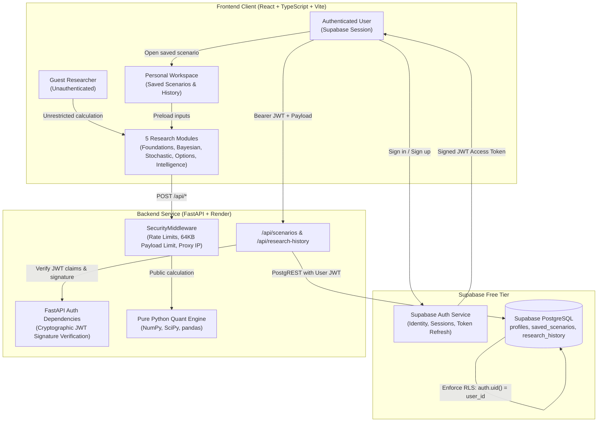

# AMQUANT Authentication, RLS & Personal Research Workspace Architecture

This document details the optional authentication system, cryptographic JWT verification, PostgreSQL Row Level Security (RLS), and personal research workspace implemented for AMQUANT.

---

## 1. System Architecture Overview

### Key Architectural Tenets
1. **Unrestricted Guest Access**: All five core quantitative modules remain 100% functional without an account or login. No quantitative calculation is gated behind authentication.
2. **True Cryptographic Verification**: The FastAPI backend never simply decodes tokens or trusts client-supplied user IDs. It cryptographically verifies signatures using Supabase JWKS (asymmetric `RS256`/`ES256`) or `SUPABASE_JWT_SECRET` (symmetric `HS256`), checking expiry (`exp`), issuer (`iss`), subject (`sub`), and audience (`aud="authenticated"`).
3. **Double-Layered Isolation**:
   - Layer 1 (Application): FastAPI validates that the requesting identity matches resource ownership.
   - Layer 2 (Database): Supabase PostgREST forwards the user's JWT to PostgreSQL, where Row Level Security (`auth.uid() = user_id`) is enforced at the database kernel level.

---

## 2. Database Schema & Row Level Security

The version-controlled migration is located at [`supabase/migrations/20261111000000_auth_and_workspaces.sql`](../supabase/migrations/20261111000000_auth_and_workspaces.sql).

### Tables

#### A. `public.profiles`
| Column | Type | Constraints | Description |
| :--- | :--- | :--- | :--- |
| `id` | `UUID` | `PRIMARY KEY REFERENCES auth.users(id) ON DELETE CASCADE` | User account identity |
| `display_name` | `TEXT` | `CHECK (char_length(display_name) <= 100)` | Public researcher display name |
| `created_at` | `TIMESTAMPTZ` | `NOT NULL DEFAULT now()` | Row creation timestamp |
| `updated_at` | `TIMESTAMPTZ` | `NOT NULL DEFAULT now()` | Last update timestamp |

*Trigger*: `on_auth_user_created` automatically provisions a profile row upon registration in `auth.users`, extracting `display_name` safely from user metadata with fallback to email username.

#### B. `public.saved_scenarios`
| Column | Type | Constraints | Description |
| :--- | :--- | :--- | :--- |
| `id` | `UUID` | `PRIMARY KEY DEFAULT gen_random_uuid()` | Scenario identifier |
| `user_id` | `UUID` | `NOT NULL REFERENCES auth.users(id) ON DELETE CASCADE` | Scenario owner |
| `title` | `TEXT` | `NOT NULL, length 1..120` | User scenario title |
| `module_name` | `TEXT` | `CHECK (module_name IN ('foundations', 'bayesian', 'stochastic', 'options', 'intelligence'))` | Target module |
| `scenario_data`| `JSONB` | `NOT NULL, max 32 KB enforced` | Model input parameters |
| `created_at` | `TIMESTAMPTZ` | `NOT NULL DEFAULT now()` | Scenario creation date |
| `updated_at` | `TIMESTAMPTZ` | `NOT NULL DEFAULT now()` | Last modified date |

#### C. `public.research_history`
| Column | Type | Constraints | Description |
| :--- | :--- | :--- | :--- |
| `id` | `UUID` | `PRIMARY KEY DEFAULT gen_random_uuid()` | History record identifier |
| `user_id` | `UUID` | `NOT NULL REFERENCES auth.users(id) ON DELETE CASCADE` | Run owner |
| `module_name` | `TEXT` | `CHECK (module_name IN ('foundations', 'bayesian', 'stochastic', 'options', 'intelligence'))` | Executed module |
| `scenario_id` | `UUID` | `REFERENCES public.saved_scenarios(id) ON DELETE SET NULL` | Linked scenario (optional) |
| `summary` | `JSONB` | `NOT NULL, max 16 KB enforced` | Concise metrics (BSM price, delta, etc.) |
| `created_at` | `TIMESTAMPTZ` | `NOT NULL DEFAULT now()` | Execution timestamp |

### Row Level Security (RLS) Policies
Every table has `ALTER TABLE ... ENABLE ROW LEVEL SECURITY;` enabled.

- `profiles`:
  - `SELECT`: `auth.uid() = id`
  - `UPDATE`: `auth.uid() = id`
- `saved_scenarios`:
  - `SELECT`: `auth.uid() = user_id`
  - `INSERT`: `auth.uid() = user_id`
  - `UPDATE`: `auth.uid() = user_id`
  - `DELETE`: `auth.uid() = user_id`
- `research_history`:
  - `SELECT`: `auth.uid() = user_id`
  - `INSERT`: `auth.uid() = user_id`
  - `DELETE`: `auth.uid() = user_id`

---

## 3. Endpoints Reference

### Authentication & Profile (`/api/auth`)
- `GET /api/auth/me`: Retrieves current authenticated profile and email.
- `PATCH /api/auth/profile`: Updates display name (`display_name: str`).

### Saved Scenarios (`/api/scenarios`)
- `POST /api/scenarios`: Saves a new scenario (`title`, `module_name`, `scenario_data`).
- `GET /api/scenarios`: Lists scenarios for the authenticated user (supports `module_name`, `limit`, `offset`).
- `GET /api/scenarios/{id}`: Retrieves an individual scenario (enforces ownership, 404 if not owned).
- `PATCH /api/scenarios/{id}`: Renames or updates scenario parameters.
- `DELETE /api/scenarios/{id}`: Deletes a saved scenario.

### Research History (`/api/research-history`)
- `GET /api/research-history`: Lists calculation runs for the authenticated user (paginated).
- `POST /api/research-history`: Records a calculation summary.
- `DELETE /api/research-history/{id}`: Deletes a single history entry.
- `DELETE /api/research-history`: Clears all history for the user.

---

## 4. Manual Supabase Setup Guide

Follow these steps to configure your Supabase Free project:

### Step 1: Create Supabase Project
1. Go to [supabase.com](https://supabase.com) and create a free project named `amquant`.
2. Select your closest hosting region and set a strong database password.

### Step 2: Apply SQL Migration
1. In the Supabase Dashboard, open the **SQL Editor** from the left navigation.
2. Click **New Query**.
3. Copy the full contents of `supabase/migrations/20261111000000_auth_and_workspaces.sql` and paste it into the editor.
4. Click **Run**.
5. Verify that tables `profiles`, `saved_scenarios`, and `research_history` appear under **Table Editor** with RLS badges active.

### Step 3: Configure Authentication Redirect URLs
1. Navigate to **Authentication** -> **URL Configuration**.
2. Set **Site URL** to:
   `https://amquant.vercel.app`
3. Under **Redirect URLs**, add:
   - `https://amquant.vercel.app`
   - `http://localhost:5173`
   - `http://127.0.0.1:5173`
4. Click **Save**.

### Step 4: Retrieve API Keys
1. Navigate to **Project Settings** -> **API**.
2. Copy:
   - **Project URL**: (e.g. `https://your-ref.supabase.co`)
   - **Project API keys -> anon (public)**: (used on frontend and backend)
   - **JWT Settings -> JWT Secret**: (used on backend for symmetric verification)

---

## 5. Deployment Environment Configuration

### Vercel Environment Variables (Frontend)
In the Vercel project dashboard (**Settings** -> **Environment Variables**):

| Variable Name | Environment | Value | Description |
| :--- | :--- | :--- | :--- |
| `VITE_API_BASE_URL` | Production | `https://amquant-api.onrender.com` | Live Render backend URL |
| `VITE_SUPABASE_URL` | Production | `https://your-ref.supabase.co` | Supabase Project URL |
| `VITE_SUPABASE_ANON_KEY` | Production | `eyJhbGciOi...` | Supabase publishable anon key |

### Render Environment Variables (Backend)
In the Render service dashboard (**Environment**):

| Variable Name | Value | Description |
| :--- | :--- | :--- |
| `CORS_ORIGINS` | `https://amquant.vercel.app` | Production CORS origin |
| `SUPABASE_URL` | `https://your-ref.supabase.co` | Supabase Project URL |
| `SUPABASE_ANON_KEY` | `eyJhbGciOi...` | Supabase anon key for PostgREST |
| `SUPABASE_JWT_SECRET` | `your-jwt-secret` | Supabase JWT Secret for cryptographic signature validation |

---

## 6. Free-Tier Resource & Operational Considerations

1. **Supabase Free Inactivity Pause**: Supabase Free projects pause after 1 week of complete database inactivity. If paused, restore the project with 1 click from the Supabase dashboard. Calculations in AMQUANT's 5 public research modules will continue working for guests even if Supabase is temporarily paused.
2. **Storage Quotas**: Supabase Free includes 500 MB database storage. Scenarios and history rows enforce maximum payload limits (32 KB and 16 KB) and store only parameter values and concise outputs (no raw 10,000-path Monte Carlo arrays), allowing thousands of saved scenarios within free quotas.
3. **Pagination & Query Limits**: All scenario and history listing endpoints enforce server-side pagination with default limits of 50 and maximums of 100 to avoid large database scans.

