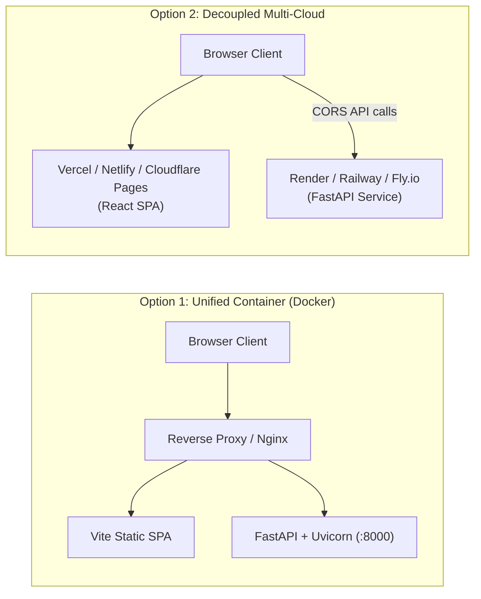

# AMQUANT Production Deployment Guide

This guide provides instructions for deploying AMQUANT to public cloud environments for portfolio demonstration and institutional review.

---

## Deployment Architecture Options



---

## Option 1: Unified Container Deployment (Docker)

AMQUANT includes a multi-stage production [`Dockerfile`](../Dockerfile) and [`docker-compose.yml`](../docker-compose.yml) in the project root:

1. **Stage 1 (`frontend-builder`)**: Compiles React + TypeScript with Vite into an optimized production bundle in `/app/frontend/dist`.
2. **Stage 2 (`backend`)**: Uses a lightweight `python:3.11-slim` image, installs NumPy, SciPy, and FastAPI requirements, copies the pure quantitative engine and built assets, and starts Uvicorn with a health check.

### Running with Docker Locally
```sh
# Build and start container
docker compose up --build -d

# Verify container health
curl -f http://localhost:8000/api/health

# View live container logs
docker compose logs -f
```

### Deploying Container to Fly.io
```sh
# Install Fly CLI and authenticate
fly auth login

# Launch application (reads Dockerfile automatically)
fly launch --name amquant-terminal --region iad --port 8000

# Set production CORS origin
fly secrets set CORS_ORIGINS="https://amquant-terminal.fly.dev"

# Deploy
fly deploy
```

### Deploying Container to Render / Railway
1. Push repository to GitHub.
2. Create a **New Web Service** and select your GitHub repository.
3. Select **Docker** as the Environment.
4. Set Environment Variables:
   - `PORT`: `8000`
   - `CORS_ORIGINS`: `https://your-app-domain.onrender.com`
5. Click **Create Web Service**.

---

## Option 2: Decoupled Cloud Deployment

### 1. Backend Service (Render / Railway / Fly.io)
- **Root Directory**: `.` (Repository root)
- **Build Command**: `pip install -r backend/requirements.txt`
- **Start Command**: `python -m uvicorn backend.app.main:app --host 0.0.0.0 --port $PORT`
- **Health Check Path**: `/api/health`
- **Environment Variables**:
  - `CORS_ORIGINS`: `https://your-frontend.vercel.app`

### 2. Frontend Application (Vercel / Netlify / Cloudflare Pages)
- **Root Directory**: `frontend`
- **Framework Preset**: Vite
- **Build Command**: `npm run build`
- **Output Directory**: `dist`
- **Environment Variables**:
  - `VITE_API_BASE_URL`: `https://your-backend-service.onrender.com`

---

## Environment Variable Reference

| Variable | Scope | Description | Production Example |
| :--- | :--- | :--- | :--- |
| `VITE_API_BASE_URL` | Frontend | URL of backend API | `https://api.amquant.io` |
| `CORS_ORIGINS` | Backend | Comma-delimited list of allowed CORS browser origins | `https://amquant.io,https://app.amquant.io` |
| `HOST` | Backend | Server bind address | `0.0.0.0` |
| `PORT` | Backend | Server bind port | `8000` |

---

## Security & Operational Checklist

- [x] Zero API keys or secrets hardcoded in frontend source.
- [x] CORS origin validation enabled with environment variable support.
- [x] Input validation enforced via Pydantic schemas (bounds checking on $S_0, K, T, \sigma, r$).
- [x] Dockerfile executes with slim base image and curl health check.
- [x] Automated benchmark test suite passes before release.
- [x] Compliance and data transparency notices clearly rendered.

