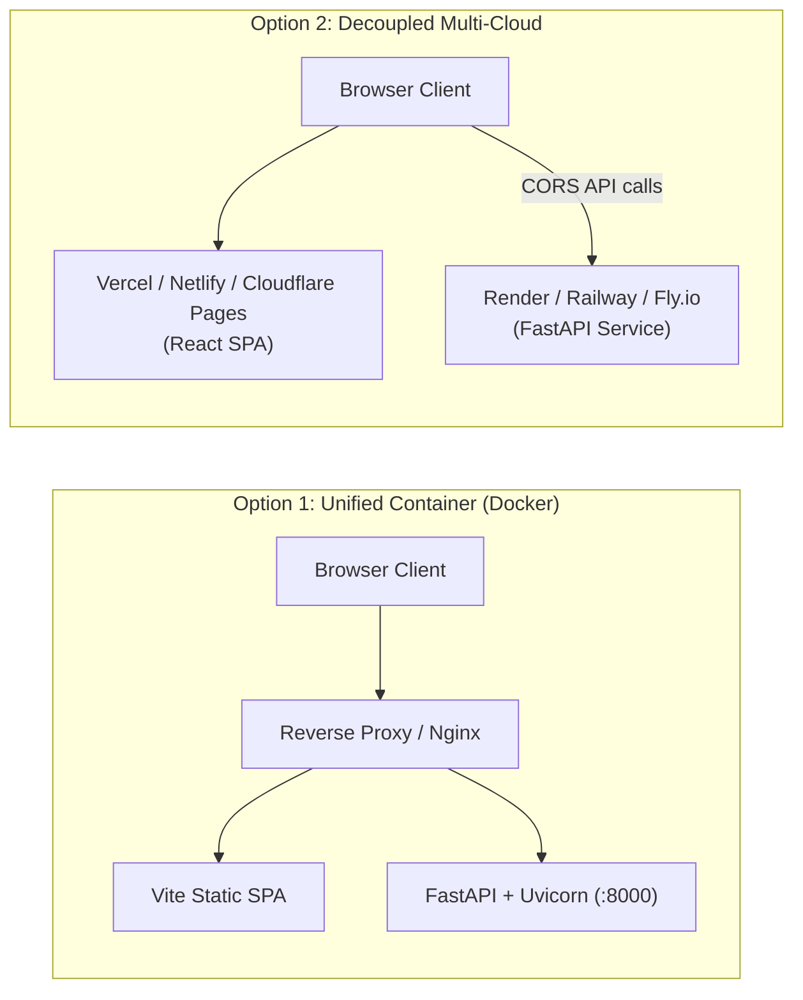

# AMQUANT Production Deployment Guide

This guide provides instructions for deploying AMQUANT to public cloud environments for portfolio demonstration and institutional review.

---

## Deployment Architecture Options



---

## Option 1: Unified Container Deployment (Docker)

AMQUANT includes a multi-stage production [`Dockerfile`](../Dockerfile) and [`docker-compose.yml`](../docker-compose.yml) in the project root:

1. **Stage 1 (`frontend-builder`)**: Compiles React + TypeScript with Vite into an optimized production bundle in `/app/frontend/dist`.
2. **Stage 2 (`backend`)**: Uses a lightweight `python:3.11-slim` image, installs NumPy, SciPy, and FastAPI requirements, copies the pure quantitative engine and built assets, and starts Uvicorn with a health check.

### Running with Docker Locally
```sh
# Build and start container
docker compose up --build -d

# Verify container health
curl -f http://localhost:8000/api/health

# View live container logs
docker compose logs -f
```

### Deploying Container to Fly.io
```sh
# Install Fly CLI and authenticate
fly auth login

# Launch application (reads Dockerfile automatically)
fly launch --name amquant-terminal --region iad --port 8000

# Set production CORS origin
fly secrets set CORS_ORIGINS="https://amquant-terminal.fly.dev"

# Deploy
fly deploy
```

### Deploying Container to Render / Railway
1. Push repository to GitHub.
2. Create a **New Web Service** and select your GitHub repository.
3. Select **Docker** as the Environment.
4. Set Environment Variables:
   - `PORT`: `8000`
   - `CORS_ORIGINS`: `https://your-app-domain.onrender.com`
5. Click **Create Web Service**.

---

## Option 2: Decoupled Cloud Deployment

### 1. Backend Service (Render / Railway / Fly.io)
- **Root Directory**: `.` (Repository root)
- **Build Command**: `pip install -r backend/requirements.txt`
- **Start Command**: `python -m uvicorn backend.app.main:app --host 0.0.0.0 --port $PORT`
- **Health Check Path**: `/api/health`
- **Environment Variables**:
  - `CORS_ORIGINS`: `https://your-frontend.vercel.app`
  - `SUPABASE_URL`: `https://your-project.supabase.co` (Optional, enables PostgREST RLS forwarding)
  - `SUPABASE_ANON_KEY`: `your-anon-key` (Optional)
  - `SUPABASE_JWT_SECRET`: `your-jwt-secret` (Optional, if verifying HS256 tokens locally)

### 2. Frontend Application (Vercel / Netlify / Cloudflare Pages)
- **Root Directory**: `frontend`
- **Framework Preset**: Vite
- **Build Command**: `npm run build`
- **Output Directory**: `dist`
- **Environment Variables**:
  - `VITE_API_BASE_URL`: `https://your-backend-service.onrender.com`
  - `VITE_SUPABASE_URL`: `https://your-project.supabase.co` (Optional, enables Auth and Workspace)
  - `VITE_SUPABASE_ANON_KEY`: `your-anon-key` (Optional)

---

## Environment Variable Reference

| Variable | Scope | Description | Production Example |
| :--- | :--- | :--- | :--- |
| `VITE_API_BASE_URL` | Frontend | URL of backend API | `https://amquant-api.onrender.com` |
| `VITE_SUPABASE_URL` | Frontend | Supabase project URL | `https://xyzcompany.supabase.co` |
| `VITE_SUPABASE_ANON_KEY` | Frontend | Supabase public anonymous API key | `eyJhbGciOi...` |
| `CORS_ORIGINS` | Backend | Comma-delimited list of allowed CORS browser origins (`https://amquant.vercel.app` included by default) | `https://amquant.vercel.app` |
| `SUPABASE_URL` | Backend | Supabase project URL for PostgREST database requests | `https://xyzcompany.supabase.co` |
| `SUPABASE_ANON_KEY` | Backend | Supabase public anonymous key for PostgREST calls | `eyJhbGciOi...` |
| `SUPABASE_JWT_SECRET` | Backend | Supabase JWT secret for symmetric token verification | `secret-string` |
| `HOST` | Backend | Server bind address | `0.0.0.0` |
| `PORT` | Backend | Server bind port | `8000` |

---

## Production Resource Hardening & Rate Limits

To operate safely on memory-constrained single-instance free tiers (e.g. Render 512MB RAM) without paid services or databases, AMQUANT enforces strict server-side resource limits:

| Resource Dimension | Enforced Upper Bound | HTTP Violation Response | Operational Rationale |
| :--- | :--- | :--- | :--- |
| **Monte Carlo Paths** | 10,000 paths max | `422 Unprocessable Entity` | Restricts NumPy array allocation to < 100 MB RAM |
| **Simulation Time Steps** | 500 steps max | `422 Unprocessable Entity` | Keeps path generation times sub-second |
| **CRR Tree Steps (Valuation)** | 500 steps max | `422 Unprocessable Entity` | Options Lab & Intelligence lattices |
| **CRR Tree Steps (Hedge Schedule)** | 50 steps max | `422 Unprocessable Entity` | Foundations module returns $N(N+1)/2 = 1,275$ node records |
| **Bayesian Observations** | 5,000 binary items max | `422 Unprocessable Entity` | Limits sequence traversal and JSON payload size |
| **Numeric Bounds** | Spot/Strike $\le 10^7$, Volatility $\le 5.0$, Horizon $\le 20$ yr | `422 Unprocessable Entity` | Prevents floating-point overflow and negative root domains |
| **Request Body Size** | 64 KB ($65,536$ bytes) max | `413 Content Too Large` | Rejects oversized or abusive POST payloads |
| **IP Rate Limit** | 30 requests / minute / IP | `429 Too Many Requests` | Sliding window per-client throttling with `Retry-After` header |
| **Concurrent Calculations** | 5 simultaneous tasks | `503 Service Unavailable` | Lightweight `asyncio.Semaphore` with 1.0s timeout to prevent OOM |

### Free-Tier Hosting Characteristics & Operational Behavior
- **Render Inactivity Spin-Down**: On Render's free tier, the backend web service spins down after 15 minutes of inactivity. When a user sends a request after an idle period, the container cold start requires 30–50 seconds. The frontend API client detects connection stalls and provides explicit cold-start guidance without breaking screens.
- **Proxy-Aware Client IP Extraction**: Render routes requests through an internal reverse proxy (`10.x.x.x`). AMQUANT parses `X-Forwarded-For` right-to-left to extract the outermost verified client IP, ignoring forwarded headers when requests arrive directly from public networks to prevent header spoofing.
- **Health Probe Exemption**: Endpoints `/api/health` and `/api/health/ready` are exempt from rate limiting to guarantee container readiness and health probes succeed continuously.
- **Traceback Sanitization**: Unhandled exceptions return generic, safe HTTP 500 messages to clients with zero exposure of stack traces, filesystem directories, or internal modules, while retaining detailed server-side error logs for operations.

---

## Security & Operational Checklist

- [x] Zero API keys or secrets hardcoded in frontend source or committed to git.
- [x] Secure CORS configuration: `https://amquant.vercel.app` supported, wildcard credentials disabled (`allow_credentials=False`).
- [x] Strict input validation enforced via Pydantic models with explicit upper bounds on all numerical parameters.
- [x] In-memory sliding window rate limiter (30 req/min) with periodic memory pruning.
- [x] Concurrency semaphore (5 concurrent calculations) offloaded to threadpools via `run_in_threadpool`.
- [x] Frontend resilience for cold starts, network errors, 429 rate limits, 503 capacity limits, and 422 validations.
- [x] Dockerfile executes with slim base image and curl health check.
- [x] Automated benchmark test suite (Pytest + Vitest + build check) passes 100%.
- [x] Compliance and data transparency notices clearly rendered.

